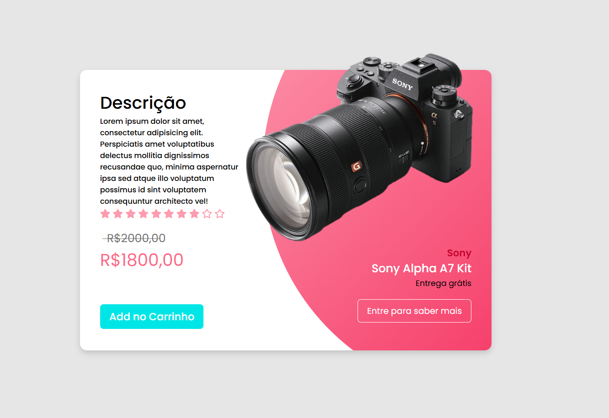

# 📷 Card de Venda de Produto

Projeto de um card de apresentação de produto, desenvolvido com **HTML5 e CSS3** como parte de uma atividade prática do curso PROA.

O projeto tem como objetivo explorar conceitos de criação de componentes para interfaces de e-commerce, organização de informações comerciais e estilização de elementos visuais, utilizando uma composição personalizada para apresentar uma câmera fotográfica.

## 🖥️ Prévia do projeto

  

🔗 **[Acesse o projeto online](https://gabrielc0liveira.github.io/Projeto10Proa-CardVendadeProduto/)**

## Funcionalidades e características

- Card de apresentação de produto com layout dividido em duas áreas.
- Exibição de imagem, marca e modelo da câmera Sony Alpha A7 Kit.
- Área de descrição do produto com avaliação visual por estrelas.
- Apresentação de preço original e valor promocional.
- Destaque visual para a informação de entrega gratuita.
- Botões ilustrativos de adicionar ao carrinho e saber mais.
- Efeito de interação no botão de adicionar ao carrinho.
- Fundo decorativo com gradiente rosa e recorte geométrico utilizando `clip-path`.
- Interface com bordas arredondadas, sombras e elementos sobrepostos.

## Tecnologias utilizadas

- **HTML5:** estruturação e organização das informações do produto.
- **CSS3:** estilização, posicionamento, efeitos visuais e criação do layout.
- **Font Awesome:** utilização de ícones para representar a avaliação do produto.
- **Google Fonts:** utilização da fonte Poppins.

## Aprendizados

Durante o desenvolvimento, foram praticados conceitos como:

- Estruturação de componentes de produtos utilizando HTML.
- Organização de layouts em duas áreas com Flexbox.
- Posicionamento de elementos utilizando `position: relative` e `absolute`.
- Criação de formas decorativas utilizando `clip-path: circle()`.
- Aplicação de gradientes com `linear-gradient()`.
- Utilização de pseudoelementos como `::before` para criar efeitos visuais.
- Personalização de preços, avaliações e informações comerciais.
- Criação de efeitos interativos utilizando `transition`, `transform` e `hover`.

## 📂 Como executar o projeto

🔗 **[Acesse o projeto online](https://gabrielc0liveira.github.io/Projeto10Proa-CardVendadeProduto/)**

---

Desenvolvido por **Gabriel Oliveira** como parte das atividades práticas do PROA.
